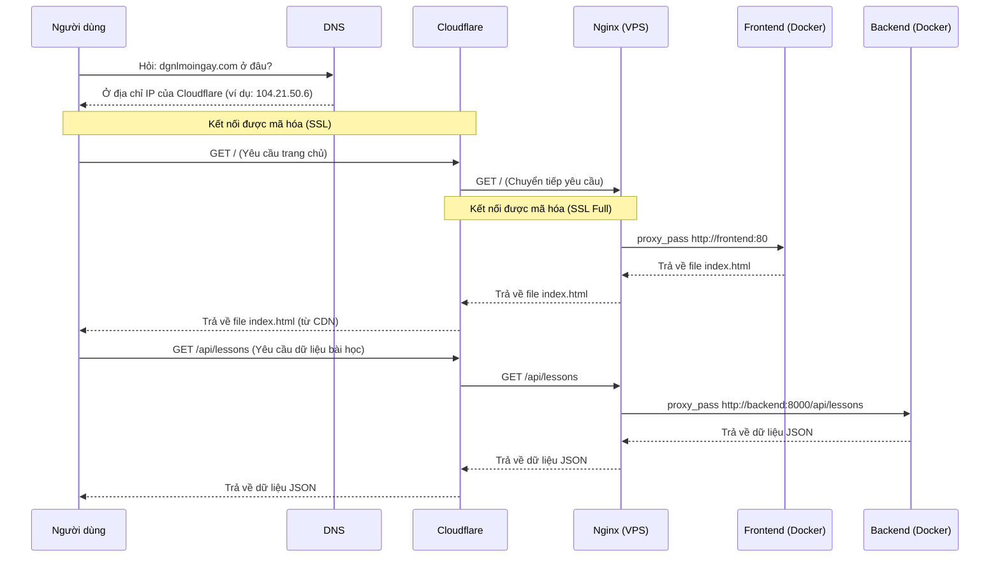

# Hướng dẫn về Mạng & Deploy

Tài liệu này giải thích cách các thành phần mạng (DNS, Cloudflare, Nginx) hoạt động cùng nhau để đưa website của bạn đến người dùng.

---

## 1. Vòng đời của một Request

Khi người dùng gõ `https://dgnlmoingay.com` vào trình duyệt, điều gì sẽ xảy ra?

---

## 2. Các thành phần chính

### a. DNS (Domain Name System)

- **Vai trò**: Giống như danh bạ điện thoại của Internet. Nó dịch tên miền (dễ nhớ cho người) thành địa chỉ IP (dễ hiểu cho máy).
- **Nameservers**: Khi bạn mua domain ở TinoHost, bạn phải "chỉ" nó vào nameserver của Cloudflare. Hành động này có nghĩa là: "Kể từ giờ, mọi thông tin về domain này, hãy hỏi Cloudflare".
- **DNS Records (tại Cloudflare)**:
  - **`A` record**: Trỏ một tên miền (vd: `example.com`) đến một địa chỉ IPv4 (vd: `203.0.113.10`).
  - **Proxy Status (Đám mây màu cam)**: Đây là tính năng cốt lõi của Cloudflare. Khi bật, Cloudflare sẽ "che" đi IP thật của bạn. Người dùng sẽ thấy IP của Cloudflare, không phải IP của VPS.

### b. Cloudflare

- **Vai trò**: Một dịch vụ proxy trung gian giữa người dùng và server của bạn.
- **Lợi ích chính**:
  1. **Giấu IP thật**: Tăng cường bảo mật, hacker không biết tấn công vào đâu.
  2. **SSL/TLS (HTTPS)**: Cung cấp chứng chỉ SSL miễn phí, mã hóa kết nối từ người dùng đến Cloudflare.
  3. **CDN (Content Delivery Network)**: Lưu cache các file tĩnh (JS, CSS, ảnh) ở nhiều máy chủ toàn cầu. Người dùng Việt Nam sẽ tải file từ server Singapore/Hong Kong thay vì từ Đức, giúp web nhanh hơn đáng kể.
  4. **Bảo mật**: Tự động chặn các cuộc tấn công DDoS, bot độc hại.

- **Chế độ SSL/TLS**:
  - **Full (Strict)**: An toàn nhất. Cả hai kết nối (User ↔ Cloudflare) và (Cloudflare ↔ VPS) đều được mã hóa. Yêu cầu bạn phải có chứng chỉ SSL trên VPS (có thể là self-signed hoặc Cloudflare Origin).
  - **Full**: Tương tự Full (Strict) nhưng không xác thực chứng chỉ trên VPS. Vẫn an toàn. **Đây là chế độ ta đang dùng**.
  - **Flexible**: Chỉ mã hóa (User ↔ Cloudflare). Kết nối (Cloudflare ↔ VPS) không được mã hóa. **Không nên dùng cho production**.

### c. Nginx (trên VPS)

- **Vai trò**: "Người gác cổng" trên server của bạn. Nó nhận tất cả request từ Cloudflare và quyết định phải làm gì tiếp theo.
- **Nhiệm vụ chính trong dự án này**:
  1. **Reverse Proxy**:
     - Nếu request là `/api/...` → chuyển cho container `backend`.
     - Nếu là các request khác (trang chủ, `/hoc-thu`, ...) → chuyển cho container `frontend`.
  2. **Chặn truy cập IP**: Server block `default_server` sẽ chặn mọi truy cập không dùng đúng tên miền `dgnlmoingay.com`.
  3. **Redirect HTTP → HTTPS**: Tự động chuyển hướng người dùng từ `http://` sang `https://`.
  4. **Cung cấp SSL**: Cung cấp chứng chỉ (self-signed) để Cloudflare có thể kết nối qua HTTPS (chế độ Full).
  5. **Tối ưu hóa**: Nén file (gzip), tăng buffer để xử lý các file lớn, thêm các security header.
  6. **Chặn file nhạy cảm**: Không cho phép truy cập các file như `.env`, `.git`.

---

## 4. Vấn đề thường gặp

### "Hmmm… can't reach this page"

- **Nguyên nhân 1: DNS Propagation (Phổ biến nhất)**
  - **Mô tả**: Bạn vừa thay đổi DNS record (ví dụ trỏ domain về IP mới). Các DNS server trên toàn thế giới cần thời gian để cập nhật thay đổi này. Có thể mất từ vài phút đến vài giờ.
  - **Kiểm tra**: Dùng một công cụ như [dnschecker.org](https://dnschecker.org/) để xem các khu vực khác trên thế giới đã nhận được IP mới chưa.
  - **Giải pháp**: Chờ đợi. Hoặc tạm thời đổi DNS trên máy tính của bạn sang `1.1.1.1` để kiểm tra.

- **Nguyên nhân 2: Firewall**
  - **Mô tả**: Firewall trên VPS (ví dụ `ufw`) hoặc của nhà cung cấp (Hetzner Cloud Firewall) đang chặn port `80` (HTTP) hoặc `443` (HTTPS).
  - **Giải pháp**: Đảm bảo cả hai port này đều được phép (allow).

- **Nguyên nhân 3: Nginx/Docker không chạy**
  - **Mô tả**: Container `nginx` hoặc toàn bộ `docker compose` bị lỗi và không khởi động được.
  - **Giải pháp**: Chạy `docker compose ps` để xem trạng thái các container. Dùng `docker compose logs nginx` để xem chi tiết lỗi.

- **Nguyên nhân 4: Cấu hình Cloudflare sai**
  - **Mô tả**: Trỏ sai địa chỉ IP trong A record, hoặc bật "Always Use HTTPS" trong khi server chưa sẵn sàng cho HTTPS.
  - **Giải pháp**: Kiểm tra lại IP trong A record. Tạm thời tắt proxy (đám mây xám) để thử kết nối trực tiếp tới IP xem có được không.
